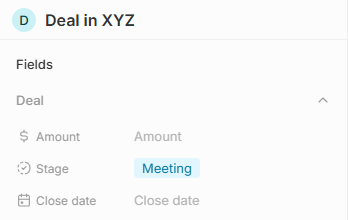
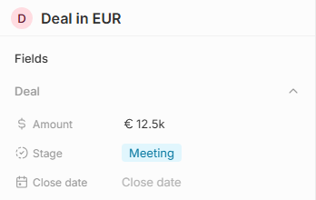

# Findings

Defects and risks found while testing Twenty and its environment. Each finding is a GitHub issue labelled [`finding`](https://github.com/Nikolay-Chillev/twenty-qa/issues?q=label%3Afinding) with steps to reproduce; this page is the summary. Findings record the Twenty version they were seen on.

**Source** separates what Twenty itself does (*product*) from how this environment is set up (*environment*).

| # | Finding | Severity | Source | Status |
|---|---|---|---|---|
| [#12](https://github.com/Nikolay-Chillev/twenty-qa/issues/12) | `/healthz` reports OK while the database is down | Minor | Product | Open, reported upstream as [twentyhq/twenty#28763](https://github.com/twentyhq/twenty/issues/28763); worked around by the server health check |
| [#17](https://github.com/Nikolay-Chillev/twenty-qa/issues/17) | A request without a token gets 403, an invalid token 401 | Minor | Product | Open, covered by the API smoke tests |
| [#30](https://github.com/Nikolay-Chillev/twenty-qa/issues/30) | An amount with a currency code that does not exist is saved, and the app hides it | Major | Product | Open, reported upstream as [twentyhq/twenty#28761](https://github.com/twentyhq/twenty/issues/28761); covered by an expected failure |
| [#31](https://github.com/Nikolay-Chillev/twenty-qa/issues/31) | Database errors reach API clients with table, constraint and index names | Minor | Product | Open, covered by expected failures |
| [#32](https://github.com/Nikolay-Chillev/twenty-qa/issues/32) | Phone numbers of any length are saved, and letters after the digits are cut off | Minor | Product | Open, reported upstream as [twentyhq/twenty#28764](https://github.com/twentyhq/twenty/issues/28764); covered by expected failures |
| [#34](https://github.com/Nikolay-Chillev/twenty-qa/issues/34) | Deleting by filter over REST has no limit and is permanent by default | Major | Product | Open, reported upstream as [twentyhq/twenty#28762](https://github.com/twentyhq/twenty/issues/28762); covered by an expected failure |

## Details

### #12 `/healthz` reports OK while the database is down

Seen on 2.48.0 and again on 2.50.0. With the database container stopped, `GET /healthz` still answers `200 {"status":"ok","info":{},"error":{},"details":{}}` while API calls fail; on a fresh start of 2.48 it also turned green before the API could serve requests. Twenty's own compose file uses `/healthz` as the server's health check and makes the worker wait for it, so an orchestrator sees a healthy server that cannot serve anything. Two upstream issues describe related symptoms (green during first-boot migrations, green while the server hangs); both are closed, but the endpoint still checks nothing in 2.50: its controller runs a health check with an empty list of indicators, although database and Redis indicators exist for the admin panel. Twenty's Helm chart uses the endpoint for its startup, liveness and readiness probes too. This environment checks readiness with a GraphQL query that needs the database ([ADR 0005](adr/0005-adjust-the-environment-for-automated-runs.md)). Reported upstream as [twentyhq/twenty#28763](https://github.com/twentyhq/twenty/issues/28763), with links to the two closed reports ([#24432](https://github.com/twentyhq/twenty/issues/24432), [#26895](https://github.com/twentyhq/twenty/issues/26895)).

### #17 A request without a token gets 403, an invalid token 401

Seen on 2.48.0 and again on 2.50.0. `GET /rest/companies` without an `Authorization` header answers `403 FORBIDDEN_EXCEPTION "Missing authentication token"`; the same request with `Bearer not-a-token` answers `401 UNAUTHENTICATED "Token invalid."`. Both requests lack valid credentials, so both should be 401; 403 is for a caller who is known but not allowed. A client that asks for credentials or refreshes its token on 401 does nothing when the token is missing. The smoke tests check both statuses as they are today.

### #30 An amount with a currency code that does not exist is saved, and the app hides it

Seen on 2.48.0 and again on 2.50.0. Creating an opportunity with `amount: {amountMicros: 12500000000, currencyCode: "XYZ"}` answers 201 over REST and GraphQL, and the code is stored as sent. The record page then shows the Amount field empty, as if the deal had no value, while the same deal in EUR shows "12.5k". The API refuses other values that are not on a list, such as a stage ("Valid values are: NEW, SCREENING, …"), so a currency code outside ISO 4217 should be refused too; as it is, an integration or an import with a typo in the currency loses the deal's value in the app. Reported upstream as [twentyhq/twenty#28761](https://github.com/twentyhq/twenty/issues/28761).

| Currency `XYZ` | Currency `EUR` |
|---|---|
|  |  |

### #31 Database errors reach API clients with table, constraint and index names

Seen on 2.48.0 and again on 2.50.0. A person linked to a company that does not exist gets `400 ["insert or update on table \"person\" violates foreign key constraint \"FK_ee066ddacfce46c9a7cb90edd1a\""]`; a second person with the same email gets `400 ["A duplicate entry was detected: unique constraint person.IDX_UNIQUE_87914cd3ce963115f8cb943e2ac was violated"]`. GraphQL returns the same text as `message` next to a friendly `userFriendlyMessage`; REST has only the raw text. The refusals are right, but they expose the database schema and do not name the field at fault.

### #32 Phone numbers of any length are saved, and letters after the digits are cut off

Seen on 2.48.0 and again on 2.50.0. A phone number is refused only when it has no digit at all (`abc`, `телефон`). With the Bulgarian calling code, `12` and `888` are saved, `08812345678901234` is saved with 16 digits (E.164 allows 15), and `088-ABC` is saved as `088` with the rest dropped and no warning. `+359 88 123 4567` is parsed correctly into `881234567`. Reported upstream as [twentyhq/twenty#28764](https://github.com/twentyhq/twenty/issues/28764).

### #34 Deleting by filter over REST has no limit and is permanent by default

Seen on 2.48.0 and again on 2.50.0. Updating companies by filter (`PATCH /rest/companies?filter=…`) refuses more than 200 matches ("Cannot update more than 200 records at once"), and a batch create refuses more than 200 records. Deleting by filter has no such limit: a filter that matched 311 companies deleted all of them in one request. REST deletes are also permanent unless `soft_delete=true` is sent; the OpenAPI document says so, but the app and GraphQL's `deleteCompany` move records to the trash, so the same word does two different things. The records deleted that way are not in the trash and cannot be restored. This suite's REST client sends `soft_delete=true` for a delete and leaves permanent deletes to `destroy()`. Reported upstream as [twentyhq/twenty#28762](https://github.com/twentyhq/twenty/issues/28762), with steps that delete 300 companies in one request.

## To investigate

- **Permission errors are 400, not 403.** An API key whose role may only read gets `400 PERMISSION_DENIED "Entity performing the request does not have permission"` when it updates a company or reads a revoked object. To be confirmed in the permission tests (Access milestone) before it becomes a finding.
- **The record table has no table semantics.** Rows and cells are plain elements without `table`, `row` or `cell` roles, and column headers are buttons, so a screen reader cannot tell which column a value belongs to. To be checked with the accessibility scans (Quality milestone).
- **Negative deal amounts.** An opportunity of −5 EUR is accepted over REST. A credit or a refund could be a reason, but nothing in the app suggests deals are meant to be negative; to be checked with how the pipeline sums amounts.
- **A new view goes first for everyone.** A view saved with "Save as new view" gets position 0, comes before "All Companies" in every member's list of views, and is what `/objects/companies` opens without a view id, for example in a new browser. The sidebar link keeps each browser's last view, so members who opened the table before are not affected. To be checked whether that order is intended.
- **Deleting a shared view takes one click.** "Delete" in a view's menu removes the view for the whole workspace at once, without a confirmation and without a trash to restore it from. Whether a member may delete a view someone else saved is to be checked in the permission tests (Access milestone).
- **The schema and the server disagree on the workspace name.** `SignUpInNewWorkspaceInput.displayName` is optional in the GraphQL schema, but `signUpInNewWorkspace` without it fails with "Workspace name is required". Minor: the app always sends a name.

## Checked, not a finding

- **The sign-in form tells whether an address has an account.**
  - An unknown address is offered to sign up instead of sign in, and a wrong password gets "Wrong password.".
  - Twenty chose clear feedback over generic messages, with rate limits as the protection ([twentyhq/twenty#3564](https://github.com/twentyhq/twenty/issues/3564)). Throttling sign-in is a feature request for now, and a captcha can be turned on instead ([twentyhq/twenty#26524](https://github.com/twentyhq/twenty/issues/26524)).
  - "Forgot your password?" gives the same answer for any address.
- **Signing up at a workspace's address needs an invitation.** Someone without one gets "User does not have access to this workspace" and is not let in.
- **A used password reset link.** It sends the user back to sign in, with a vague "You do not have permission to perform this action." rather than a word about the link.
- **One rate limit for all API keys of a workspace.** A new API key gets 429 as soon as another key of the same workspace has used up the 100 requests per minute, and the message says "Rate limit exceeded for apiKey". This is by design: the default limit is one pool per workspace, as a comment in Twenty's source explains, and other workspaces are not affected.
- **A session cookie from API sign-in.** `signIn` over GraphQL also sets the web app's `twenty-session` cookie, and later cookie-authenticated calls without a matching `Origin` header are refused with `CSRF_ORIGIN_MISMATCH`. That is the expected CSRF protection; the suite authenticates with tokens and drops the cookie.
- **Records without a name.** A company or an opportunity created without a name is saved with an empty one, the way the app creates an untitled record before the user types; covered by a test.
- **Page size.** `limit` above 200 returns 200 records without an error, as the OpenAPI document gives 200 as the maximum; a negative limit is refused.
- **Trash and links.** A person keeps their link to a company while the company is in the trash and after it is restored; destroying the company keeps the person and clears the link.
- **Sample data in every new workspace.** A new workspace comes with companies and people such as Airbnb and Stripe. Intended as a demo; tests do not rely on it.
- **Empty names on the user.** After onboarding through the API, `currentUser.firstName` is empty while the workspace member has the name. The app shows the member's name, which is where Twenty keeps it per workspace.
- **Tenant isolation.** An API key of one workspace gets 404 for another workspace's records on read, update and delete, and a browser session is bound to its workspace's subdomain ([ADR 0001](adr/0001-run-twenty-with-multiple-workspaces.md)). To be covered by tests in the Access milestone.
